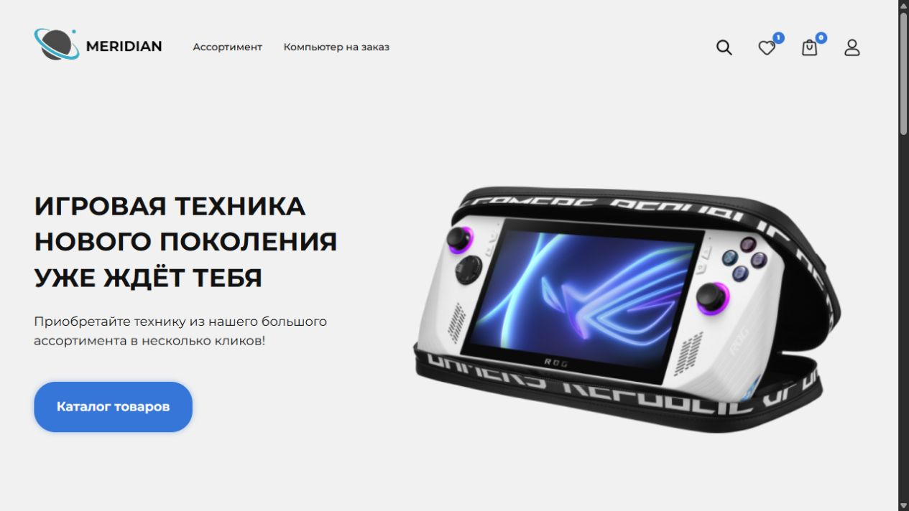

# Meridian Electronics

A full-stack electronics storefront built with Angular, Express and SQLite. The project demonstrates a complete local shopping flow, account management and persistent application data.

> **Demo scope:** catalog items and orders are for demonstration. The application does not process real payments, arrange delivery or notify an operator.

## Storefront preview



## Features

- Responsive storefront with searchable catalog, category and brand filters, price sorting and pagination.
- Product details and stock availability.
- Registration, sign-in, sign-out, profile editing and password changes.
- Per-account wishlist and cart, checkout and order history.
- Custom PC requests with budget and requirements.
- Server-calculated order totals and atomic stock updates.

## Technology

Angular 22 · TypeScript · SCSS · Node.js 24 · Express 5 · SQLite

## Engineering decisions

- **Authentication:** salted scrypt password hashes and hashed session tokens.
- **Session handling:** HttpOnly and SameSite=Lax cookies; Secure cookies in production.
- **Database access:** parameterized SQL statements.
- **Request protection:** request-size limits, origin checks and rate limits.
- **Checkout consistency:** order creation and stock changes run in a single SQLite transaction.
- **Account isolation:** integration tests verify that users cannot access another account's cart, wishlist or orders.

## Run locally

Use Node.js 24.15 or later in the 24.x release line.

```sh
npm ci
npm run build
npm start
```

Open [http://localhost:3000](http://localhost:3000) and create a local test account. There are no bundled users or passwords. SQLite is initialized automatically at `data/meridian.sqlite`.

For development, use `npm run dev`: Angular runs on port 4200 and proxies API requests to port 3000. On Windows PowerShell, use `npm.cmd` if script execution is restricted.

## Configuration

Environment variables are documented in `.env.example`. Set them in your shell or use Node's `--env-file` support; the app does not automatically load `.env`.

| Variable | Default | Purpose |
| --- | --- | --- |
| `PORT` | `3000` | Server port |
| `DB_PATH` | `data/meridian.sqlite` | SQLite file |
| `APP_ORIGIN` | `http://localhost:3000` | Allowed browser origin |
| `NODE_ENV` | `development` | Production enables Secure session cookies |

## Automated checks

```sh
npm test
npm run build
npm run format:check
```

The API integration suite uses an in-memory database. It covers account isolation, authentication, cart validation, stock updates, server-calculated totals, transaction rollback, profile changes, password rotation and logout.

## Project layout

| Directory | Responsibility |
| --- | --- |
| `src/app/` | Standalone Angular components, signal-based state and API access |
| `server/` | Express API, database schema and seed catalog |
| `tests/` | Isolated API integration tests |
| `public/` | Storefront assets |
| `docs/` | Project documentation and preview assets |

## Scope and limitations

This is a portfolio demo, not a production commerce service. Payment processing, email verification and recovery, delivery integration, admin inventory/order management and order cancellation are not implemented. Orders remain in their initial state. SQLite is intended for one server process.

A production deployment would additionally require HTTPS, persistent storage, correctly configured proxy trust, backups and monitoring. Do not commit live databases, user exports or credentials.

See [the original Russian setup notes](docs/README.ru.md) for additional context. Product images and brand marks are retained from the original project; no ownership of third-party marks is claimed.
